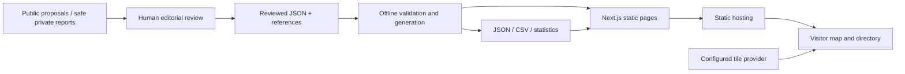

# Scattered Stars Implementation Specification

**Technical specification — v0.5**  
**Updated:** 2026-10-12  
**Product authority:** [Design Doc.md](Design%20Doc.md)  
**Delivery plan:** [implementation plan](docs/superpowers/plans/2026-10-12-atlas-release.md)

## 1. Purpose and current state

This document defines the data, UI contracts, architecture, tests, and operations for the product design. Product intent, editorial scope, theoretical framing, and visual identity live in the design document.

The development implementation includes version-2 nodes, version-1 relationships, checked references, atomic joined exports, directory/network filters and shareable selections, a clustered map with one-hop partner context, device location, profiles, and bilingual static contribution/questionnaire drafts. Canonical reviewed nodes and relationships remain empty; synthetic fixtures are opt-in and visibly labelled. Functional checks and the remaining launch evidence are recorded in [docs/verification.md](docs/verification.md).

The owner authorized development, creation of [yuna-yang/chinese-diaspora-atlas](https://github.com/yuna-yang/chinese-diaspora-atlas), and a dummy development contact. The repository has been created; creating it does not establish that code has been pushed or a site deployed. The dummy contact remains explicitly nonfunctional. A real private contact is still a public-launch gate.

## 2. Decisions and revision boundary

Retain the static React/TypeScript/Next.js/Leaflet architecture and reviewed JSON workflow. Add an evidence-based relationship dataset and integrated edge layer, connected institution records, profile founding/reach/contact context, and a web proposal/questionnaire form. These supersede v0.4's deferral of relationships. Preserve the existing device-location contract.

No automated discovery, Hong Kong layer, event calendar, history browser/time slider, researcher API, account system, impact ranking, or advanced graph analysis. Past relationships with evidenced periods are ordinary relationship records, not a history browser.

The following target data/interaction contracts are normative. The v0.4 fixtures and contracts have been migrated. The execution plan distinguishes implemented development features from editorial, performance and hosting work still required for public launch.

## 3. Data contract

### Storage/schema

UTF-8 JSON records live at `data/organizations/<id>.json`; `data/schema/organization.schema.json` uses JSON Schema draft 2020-12 and rejects unknown properties. IDs are unique immutable lowercase slugs matching `^[a-z0-9]+(?:-[a-z0-9]+)*$`; filenames equal IDs. Display-name changes do not change IDs. Do not encode mutable city/category information into IDs.

| Field                      | Type and constraint                                                                                                                 |
| -------------------------- | ----------------------------------------------------------------------------------------------------------------------------------- |
| `schema_version`           | Integer, exactly `2`                                                                                                                |
| `id`                       | Stable unique slug                                                                                                                  |
| `kind`                     | Required `primary` or `institution`; separates eligibility, labels, and counts                                                      |
| `institution_type`         | Null for primary; required connected-institution enum otherwise                                                                     |
| `names`                    | `{zh: string \| null, en: string \| null}`; at least one nonblank name, <=160 characters each                                       |
| `translated_name_locales`  | Unique array of `zh`, `en`; marked locale must have a name                                                                          |
| `aliases`                  | Unique strings; <=10, <=160 characters each                                                                                         |
| `descriptions`             | `{zh: string \| null, en: string \| null}`; at least one nonblank summary, <=600 characters each                                    |
| `categories`               | Unique taxonomy IDs; nonempty for primary, may be empty for institutions                                                            |
| `keywords`                 | Unique public descriptive strings; <=15, <=80 characters each                                                                       |
| `locations`                | Unique `{city_id: string \| null, country_code: string}` references                                                                 |
| `online_only`              | Boolean; true requires no locations; false requires at least one                                                                    |
| `links`                    | Nonempty array of `{kind: website \| social, url: string}`; organization-owned                                                      |
| `sources`                  | Nonempty array of source objects defined below                                                                                      |
| `activity_status`          | `active`, `inactive`, or `unknown`                                                                                                  |
| `affiliation`              | `{kind: independent \| government_linked \| unclear, explanation: {zh: string \| null, en: string \| null}, source_urls: string[]}` |
| `inclusion_basis`          | Nonblank rationale, <=600 characters, supported by sources                                                                          |
| `last_verified`            | Valid calendar date `YYYY-MM-DD`, not future                                                                                        |
| `created_at`, `updated_at` | Nonfuture dates; `created_at <= updated_at`, `last_verified <= updated_at`                                                          |
| `founded_year`             | Integer 1000 through release year, or null; a value requires `founded` evidence                                                     |
| `reach`                    | Null or `{scope, summary: {zh: string \| null, en: string \| null}, source_urls: string[]}`; descriptive, never a score             |
| `public_contacts`          | Array of `{kind: contact_page \| role_email, value: string, source_url: string}`; public organization-owned routes                  |
| `information_basis`        | `public_documentation`, `organization_contribution`, or `organization_reviewed`; editorially substantiated provenance               |

All listed fields are required; use `null` for missing translated text, not blank strings. Lengths use Unicode code points consistently. Trim text and reject whitespace-only values. Source objects contain `url`, `title` (1–300 characters), `accessed_at` (valid nonfuture date), `supports` (nonempty unique array of `identity`, `scope`, `location`, `activity`, `affiliation`, `founded`, `reach`, `contact`), and `reuse_basis` (`original_summary`, `permission`, `open_license`). The latter two require a nonblank `license_note`; the first permits independently written factual summaries, not copied text/media. Reject duplicate source URLs. Sources collectively support `identity`, plus `scope` for primary diaspora entries and `location` for physical entries. Connected institution eligibility also requires an approved direct relationship to a primary organization.

Institution enums: `culture`, `education`, `ngo`, `municipality_public`, `migrant_diaspora`, `media`, `foundation_funder`, `commercial`, `state_affiliated`, `other`. Primary records require a category; institutions may have empty primary categories and must have an institution type. Institutional type does not classify a relationship.

Reach scopes: `local`, `regional`, `national`, `transnational`, `online`, `unclear`. A reach object needs a summary in at least one language and nonempty URLs present in sources supporting `reach`. Never infer reach from branch/partner counts. Contact pages follow HTTPS URL rules; role mailboxes must be valid, nonpersonal, and publicly organization-owned, with sources supporting `contact`. Reviewers establish ownership/permission.

Source objects additionally permit `kind: public_source|organization_statement`, defaulting to public source. Statements need a shareable statement URL and recorded publication permission; confidential testimony and consent records never enter exports. Governance eligibility follows the design: institutional collaboration or funding alone does not prove government operation/lack of autonomy.

Affiliation `unclear` permits empty evidence/explanations. Positive classifications require sources supporting `affiliation` and an explanation. Government-operated excludes a primary organization but can describe a connected institution through its type and evidenced explanation. `active`/`inactive` requires activity evidence; broken links/infrequent posting alone are insufficient.

URLs must be absolute HTTPS with a hostname and no user information/private invitation token. Normalize host casing/default ports for comparison; preserve path/query case and semantics. Reject `javascript:`, `data:`, `file:`, and other schemes. Syntax validation is automated; organization ownership and sensitivity require editorial review.

### Taxonomy/reference data

`data/reference/categories.json` defines stable IDs and bilingual labels:

`community_culture`, `student_alumni`, `professional`, `civic_advocacy`, `feminist`, `lgbtq`, `religion`, `mutual_aid`, `media`, `arts_intellectual`, `other`.

Categories can overlap. Use `other` only when no existing category fits. Classify from public self-description, never private identity.

`countries.json` contains stable ISO 3166-1 alpha-2 codes and bilingual display names. `cities.json` contains stable city IDs, country codes, bilingual names/aliases, centroid latitude/longitude, and coordinate provenance/reuse information. Reference data only needs supported locations. Country codes are interoperability keys; names are editorial display choices. Validate city-country consistency, latitude `[-90,90]`, longitude `[-180,180]`, and source compatibility. Organization records reference cities; they cannot contain arbitrary coordinates.

Reference files are arrays with unique IDs/codes. Category objects are `{id, labels: {zh, en}}`; country objects are `{code, names: {zh, en}, aliases: string[]}`; city objects are `{id, country_code, names: {zh, en}, aliases: string[], latitude: number, longitude: number, source: {url, title, accessed_at, reuse_basis, license_note?: string}}`. Both reference-language labels are nonblank. Apply source URL/date/reuse rules to city provenance and reject unknown reference properties. The source for coordinates must support the centroid value; organization evidence supports the group's actual city scope independently.

A multi-branch group has one record/multiple locations unless branches are independently named/operated. Directory/statistics deduplicate by organization ID; markers represent each distinct city location. Coincident city markers must reveal every group through clusters/list popups.

### Freshness and deduplication

- Verification records a human evidence check, never just a successful HTTP request.
- Stale means more than 180 days since verification at the release build date: day 180 is fresh, day 181 stale. Label freshness “as of dataset release”; only a rebuild changes it.
- Stale/unknown entries remain visible with uncertainty. Default directory includes active/unknown; inactive requires opting in.
- Duplicate suggestions use normalized names/aliases plus overlapping locations, or matching organization website URL. A shared social platform hostname is insufficient.
- Never auto-merge. Reviewed legitimate pairs go into `data/duplicate-decisions.json` as sorted ID pairs with reasons; dangling IDs fail validation. Deletion also removes relevant pair decisions.
- No public hidden-record archive.

### Synthetic example

This illustrates the schema only. `example.org` and `demo-city` are test fixtures and must not enter production data.

```json
{
  "schema_version": 2,
  "id": "example-collective",
  "names": {
    "zh": "示例社群",
    "en": "Example Collective"
  },
  "translated_name_locales": [],
  "aliases": [],
  "descriptions": {
    "zh": "面向中国离散社群的文化交流组织。",
    "en": "A cultural exchange collective serving mainland Chinese diaspora communities."
  },
  "categories": ["community_culture"],
  "keywords": ["文化", "culture"],
  "locations": [
    {
      "city_id": "demo-city",
      "country_code": "DK"
    }
  ],
  "online_only": false,
  "links": [
    {
      "kind": "website",
      "url": "https://example.org/"
    }
  ],
  "sources": [
    {
      "url": "https://example.org/about",
      "title": "About the example collective",
      "accessed_at": "2026-10-12",
      "supports": ["identity", "scope", "location"],
      "reuse_basis": "original_summary"
    }
  ],
  "activity_status": "unknown",
  "affiliation": {
    "kind": "unclear",
    "explanation": {
      "zh": null,
      "en": null
    },
    "source_urls": []
  },
  "inclusion_basis": "The synthetic primary source documents mainland diaspora service abroad.",
  "last_verified": "2026-10-12",
  "created_at": "2026-10-12",
  "updated_at": "2026-10-12",
  "kind": "primary",
  "institution_type": null,
  "founded_year": null,
  "reach": null,
  "public_contacts": [],
  "information_basis": "public_documentation"
}
```

### Relationship records

Reviewed edges live at `data/relationships/<id>.json`, validated by `data/schema/relationship.schema.json` (draft 2020-12, no unknown properties). All following fields are required. Candidates are not public edges.

| Field                                       | Contract                                                                                                                                       |
| ------------------------------------------- | ---------------------------------------------------------------------------------------------------------------------------------------------- |
| `schema_version`, `id`                      | Version `1`, immutable unique slug matching filename                                                                                           |
| `source_id`, `target_id`                    | Existing distinct node IDs; at least one primary endpoint in this release                                                                      |
| `direction`                                 | `directed` or `undirected`; directed source provides support/resources to target                                                               |
| `types`                                     | Unique subset of `bonding`, `bridging`, `linking`; empty means unclassified                                                                    |
| `forms`                                     | Nonempty subset of `co_event_project`, `space_resources`, `funding_support`, `knowledge_exchange`, `referrals`, `ongoing_cooperation`, `other` |
| `descriptions`                              | Bilingual nullable summaries; at least one nonblank, <=600 characters each                                                                     |
| `classification_basis`                      | Bilingual nullable explanation; required when types is nonempty                                                                                |
| `period`                                    | `{start: string \| null, end: string \| null, label: {zh: string \| null, en: string \| null}}`; preserve evidence precision                   |
| `temporal_status`                           | `current`, `past`, `unknown`; current is as of verification, not a guarantee                                                                   |
| `source_city_id`, `target_city_id`          | Nullable anchors; nonnull city must belong to that endpoint                                                                                    |
| `sources`                                   | Nonempty source objects with supports from `relationship`, `period`, `classification`, `direction`                                             |
| `information_basis`                         | Same provenance enum as nodes; testimony needs shareable attribution/permission                                                                |
| `last_verified`, `created_at`, `updated_at` | Valid nonfuture dates, same ordering rules as nodes                                                                                            |

Sources use node URL/title/access/reuse rules and must support meaningful cooperation. Positive characteristics need classification evidence/explanation; directed edges need direction evidence; dated periods or positive temporal status need period evidence. Mentioning, following, recommendation lists, shared ethnicity/venues, or attending the same event alone are insufficient.

Period dates are valid `YYYY`, `YYYY-MM`, or `YYYY-MM-DD`; compare the earliest possible start against the latest possible end. Reject impossible reversed intervals; no end does not imply currentness. Unknown dates remain null with explanatory labels. Future-start proposed cooperation stays unpublished; a current evidenced agreement may have a future end. Past edges remain honestly labelled unless safety/removal review requires deletion.

Canonically order undirected endpoints by ID and reorder their city anchors. Preserve provider-to-recipient order for directed edges. Multiple records between the same nodes are allowed for distinct forms/periods/evidence; report likely redundant records instead of auto-merging. Explained exceptions live in `data/relationship-duplicate-decisions.json` as sorted edge-ID pairs.

Institutions need an approved direct edge to a primary node. Reject orphan institutions and dangling edges. Removing a node removes current incident edges and triggers review/removal of institutions that no longer qualify. No recursive inventory of unrelated institutions, hidden archives, or “isolated” labels.

### Version-1 migration

Explicitly upgrade old organization records/fixtures to version 2 with `kind=primary`, `institution_type=null`, `founded_year=null`, `reach=null`, `public_contacts=[]`, `information_basis=public_documentation`. Migration must not invent facts, governance, reach, or relationships. Regenerate types; final validation rejects version-1 nodes.

## 4. Generated dataset, downloads, statistics

One deterministic builder validates reviewed records/references, sorts records by ID, and creates every public data artifact. Map, directory, profiles, exports, and counts consume the same release. Never maintain a second hand-edited dataset or fetch source websites during builds/runtime.

Generated files under `website/public/data/`:

- `atlas.json`: complete client snapshot `{schema_version: 2, dataset_version, generated_at, license, attribution, reference_data, organizations, relationships}`. Load it once; all UI/profile/count data uses that release.
- `organizations.json`: version-2 node envelope with metadata, full references, and all primary/institution records.
- `relationships.json`: `{schema_version: 1, dataset_version, generated_at, license, attribution, relationships}`; join nodes through stable IDs.
- `organizations.csv`: UTF-8 with BOM, CRLF, standard CSV quoting, stable headers, one row per organization.
- `relationships.csv`: one edge per row, stable headers/ID order and the same CSV safety rules.
- `statistics.json`: matching version plus derived counts for the data page.

All outputs share a SHA-256 of canonical sorted nodes, edges, references, and license/attribution declarations, excluding generation time. Publish the applicable license files beside exports. No mixed-release snapshots.

Node CSV headers: `id,kind,institution_type,founded_year,reach,public_contacts,information_basis,name_zh,name_en,description_zh,description_en,categories,locations,online_only,activity_status,affiliation,last_verified,links,sources`. Edge headers: `id,source_id,target_id,direction,types,forms,description_zh,description_en,classification_basis,period,temporal_status,source_city_id,target_city_id,information_basis,last_verified,sources`. Missing translations become empty cells. Arrays/objects use compact JSON. Locations include resolved city/country labels/centroids; country-only coordinates are null. Prefix formula-leading `=,+,-,@` text (ignoring leading whitespace), or cells starting with tab/CR/LF, with an apostrophe. Document this CSV-only transformation; JSON preserves text.

Exports contain all currently published records, including inactive ones, regardless of directory filters. Filtered exports are deferred. Include license/attribution/version with downloads. Validation failure publishes no partial new artifacts: generate in a temporary directory and replace outputs only after success.

Statistics show total organizations, activity counts, stale count, online-only count, and category/country counts. An organization counts once per distinct category/country, so those sums may exceed the total. City counts use distinct organizations, not markers. Explain that counts measure this curated dataset, not diaspora population/completeness. Show release timestamp and definitions; no sensitive subgroup rankings.

Organization/geography/category/activity counts refer to primary nodes. Show connected-institution and approved-edge totals separately, plus recorded relationship-characteristic/period counts with overlap notes. These describe coverage, never impact or social isolation; do not introduce an analytical dashboard or degree leaderboard.

## 5. Routes and interaction contracts

Keep one atlas route for geography/network. Institutions use the same node profile route, with kind/type clearly labelled. Relationships use evidence panels/profile-list anchors, not a separate network-map route.

| Route                           | Purpose                                                         |
| ------------------------------- | --------------------------------------------------------------- |
| `/`                             | Static link/client redirect to `/en/`; no runtime middleware    |
| `/<locale>/`                    | Map and directory                                               |
| `/<locale>/organizations/<id>/` | Generated profile                                               |
| `/<locale>/about/`              | Scope/methodology/classification definitions                    |
| `/<locale>/contribute/`         | Proposal routes and public/private warning                      |
| `/<locale>/privacy/`            | Data minimization, provider disclosure, private removal contact |
| `/<locale>/data/`               | Downloads, counts, license/attribution/version                  |

Locale is `en` or `zh-CN`; map schema text key `zh` explicitly to UI locale `zh-CN`. Generate every profile in both locales. Unknown/deleted IDs show static not-found, never another organization's profile. Use trailing slashes and configurable base path. All direct links/refreshes/assets/downloads must work on repository subpaths.

### Atlas layout/map

Desktop: header, search/filters, directory panel, map. Mobile: directory by default with map/list toggle; retain filters/selection across views. Map starts at world view (zoom 2, latitude 20/longitude 0). Only “Show results on map” fits filtered marker bounds. Panning does not change results. Selecting a list item reveals its preview and highlights city marker(s); country/online-only entries show an explanation instead.

### Visitor auto-location

Provide a visible keyboard/touch-accessible **“Use my location / 使用我的位置”** button on the atlas, including the mobile directory view. On activation, request a one-time device position through `navigator.geolocation.getCurrentPosition`; after permission and success, automatically center the map on that position. Do not request permission on initial page load or continuously track movement. Browser location access requires permission and a secure context; deploy over HTTPS and use a supported localhost origin for development. See the [W3C Geolocation specification](https://www.w3.org/TR/geolocation/).

- Use `{enableHighAccuracy: false, timeout: 10000, maximumAge: 60000}`; approximate device location is sufficient. A second activation requests a new position subject to this maximum age.
- States are `idle`, `locating`, `located`, and `error`. Disable repeat requests while locating; announce progress/result through a polite live region. Browser permission dialogs are controlled by the browser.
- On success, switch the mobile view to the map, center at device latitude/longitude with zoom 10, and show a visually distinct “Your location / 你的位置” marker with the reported accuracy circle. If accuracy exceeds 5,000 m, use zoom 6 and label the position approximate. Never imply GPS-level precision or confuse the visitor marker with an organization marker.
- Validate finite latitude/longitude and nonnegative finite accuracy. Invalid results become an unavailable-position error. Location changes the viewport only: preserve query, filters, result order, page, and organization selection; do not silently hide organizations or claim a nearby-distance ranking.
- Permission denial explains how to enable location in browser settings; unavailable/timeout errors offer a user-triggered retry; unsupported or insecure contexts explain the limitation. All cases retain manual city/country search and the previous usable viewport. No automatic retry, IP-location fallback, or reverse-geocoding request.
- “Clear my location / 清除我的位置” removes the visitor marker/accuracy and temporary position without changing filters or the viewport. Ignore late callbacks after clearing, navigating away, or starting a newer request; location must not reappear unexpectedly.
- Panning, organization selection, and “Show results on map” can override the centered viewport; a fresh location-button activation recenters. Location is not included in share links or persisted across route navigation/reload. A new atlas visit begins at the world view unless the visitor locates again.

This feature provides automatic positioning after the visitor chooses it, while preserving a fully functional atlas when location access is refused.

The directory is authoritative for accessibility/search and remains usable when the map fails. Lazy-load Leaflet on the client into a reserved region. Never import browser-only map modules into server routes. Use client-side Supercluster over filtered city markers, cluster zoom cap 12. Cluster click zooms when useful; at the cap reveal a selectable list for coincident points. Pin compatible dependencies after a build/marker smoke check.

Directory pages contain 20 results. Reset page to 1 when query/filters change; list each group once regardless of locations. Sort by locale-aware display name with ID tie-breaker. Show matching count and clear controls. No-results offers reset/contribution; initial data failure offers retry/explanation. Tile/map failures must not hide profiles/downloads/results.

### Search/filter/state

Add node-kind filter `primary|institution|all` (default primary), institution-type filter when institution/all is selected, relationship-characteristic multiselect (default all four, including unclassified), and period-status selection (default current/past/unknown). Category filters apply to primary nodes; institution types apply to institutions. Other physical/activity/text dimensions apply normally.

Relationship filters use OR over characteristics and AND with period status. Empty edge types match unclassified only. These filters never remove a primary organization merely because it has no matching edge. Both primary partners and institutions may appear as one-hop map context outside node filters; label them “outside current filters” and do not increase filtered directory counts.

Text normalization: Unicode NFKC, trimmed/collapsed whitespace, locale-independent case folding. Split query by whitespace; every token must occur as a substring in combined searchable fields. Search both-language names/descriptions, aliases, keywords, and resolved city/country names regardless of UI locale. Pinyin, fuzzy search, and Traditional/Simplified conversion are deferred.

Categories are multi-select OR; combine category, country, city, activity, and online-only dimensions with AND. Country/city are single-select and must match the same location object. City options follow country; clear incompatible city selection. Online-only clears physical filters; choosing country/city clears online-only. Default statuses are active/unknown; support inactive and all statuses.

Selecting a city also selects its country. In incoming URLs, a known city without a country infers that country; a city inconsistent with an explicit country is discarded. `online=1` takes precedence over physical URL filters. Missing or wholly invalid status selections default to active/unknown; encode “all statuses” using all three repeated status values. With zero matches, show page 1 and no pagination controls.

URL parameters: `q`, repeated `category`, `country`, `city`, repeated `status`, `online=1`, `page`. Sort repeated parameters for canonical links. Ignore unknown enums/invalid city-country pairs; default invalid/nonpositive page to 1 and clamp oversized pages. Query maximum 200 characters. Debounce typing 200 ms and replace history during typing; deliberate filter changes/profile navigation create history entries. Back/forward restores state. Locale switching preserves query/filters/page and profile ID.

Extend parameters with `kind`, `institution`, repeated `relation_type`, repeated `period_status`, `node`, and `relationship`. Missing/invalid edge-characteristic/period selections default to all. An explicit `node` may select any currently published node, including a primary partner outside filters; label that context without changing filters or directory counts. Selected edge must be incident to it and pass edge filters. Discard unknown/deleted IDs. Selecting a contextual partner makes it the new one-hop center, allowing deliberate navigation through the documented network without recursively expanding all partners. Locale/back/forward preserve selections; coordinates never enter links.

### Integrated edge layer

At world scale, cluster equal-size nodes and suppress crowded lines. Selecting a node exposes its approved matching one-hop connections/partners of either kind on the same map, even across location/category filters; regional views can show qualifying edges in filtered primary context. For example a Copenhagen-filtered group can reveal/select its Berlin primary partner while the directory remains Copenhagen-filtered. Always offer equivalent relation lists. Primary star nodes and institution rounded-square nodes share baseline dimensions. Fixed line width/node size/result order must not depend on degree, reach, age, or funding.

Use accessible colors plus line styles/badges for characteristics, neutral styling for unclassified, and arrows plus explicit provider-to-recipient text for directed support. Multi-type edge panels display all characteristics. Panels include endpoints, forms, dates/status, provenance, verification, evidence, and correction/removal. Keyboard selection/close restores focus.

Explicit anchors must belong to endpoint locations; otherwise infer a city only if that endpoint has exactly one city. Ambiguous multi-city/online/country-only endpoints have relation lists but no fabricated lines/country centroids. Coincident anchors use a schematic loop or selectable cluster relation list, so zero-length lines cannot hide connections. These are cooperation diagrams, not travel routes or premises. No-recorded-edge messages describe incomplete documentation, never isolation.

### Web contribution/questionnaire form

On `/<locale>/contribute/`, provide bilingual add-node, add-edge, correction, translation, and voluntary-questionnaire modes. Validate safe evidence links, original summaries, and known IDs; proposed unknown endpoints remain candidates. Use city/country fields, never exact address fields. Include the six design-document questionnaire prompts and field-level permission for public sharing. Answers are not a condition of directory inclusion.

Transport stays static: preview, download proposal JSON, and prepare a mail draft for a configured editorial inbox. Non-GitHub participants send/attach it in their own mail client. Say “draft prepared,” never “delivered/submitted.” GitHub handoff includes only explicitly public-approved fields, never confidential questionnaire material. A hosted form API/storage can be added later through a separate transport decision.

Dummy development contact: `placeholder@example.invalid`, explicitly nonfunctional. Preview/download works until a real inbox exists; send/removal actions remain disabled. Use the actual created repository URL. Public launch requires a tested non-GitHub delivery route and real private contact; a downloaded proposal is not successful delivery.

### Profiles/localization

Show name, translated-name indicator, summary, categories, geographic/online scope, activity/affiliation uncertainty, freshness, source/access dates, public links, and correction/removal routes. Date display is localized; machine values remain ISO.

Also show node kind/institutional character, sourced founding year/reach/organizational contacts, information basis, and approved incident relationships with linked partners, concrete forms, direction, periods, and evidence. Omit or label unknown secondary facts; never guess, rank, or score them.

Missing requested-language text displays the available language with an explicit fallback label and correct `lang` attribute. No rendering-time invented translation or official name. UI dictionaries cover metadata, labels, empty/error states, controls, category/reference names, and screen-reader text in both locales. Organization translations may be completed incrementally with labelled fallback. Set document language. Optional locale local storage has URL precedence and must fail gracefully when blocked. No cookies required.

## 6. Visual direction and accessibility

Preserve **cute, vivid, playful, queer-spirited, improvised, emerging**: bright accents, stars/seeds/roots, stickers, organic shapes, and small movements. It should feel community-built while keeping information legible and navigation predictable.

- Define CSS tokens for surface/text/accent/category colors, spacing, typography, focus, radii, and elevation.
- Start with off-white surfaces/dark text and expressive pink/teal/yellow accents. Final colors/icons are delegated after contrast checks.
- System sans-serif fonts with Chinese fallbacks; handwritten accents never replace readable controls or long text. No remote fonts.
- Category colors always have text/icon labels. Explain that markers are approximate coverage, not premises.
- Respect reduced-motion preferences; no flashing, autoplay motion, or drifting markers that obstruct use.

Target WCAG 2.2 AA: semantic landmarks/skip link, visible unobscured focus, labelled controls, keyboard-operable dialogs with restored focus, heading order, and announced result counts. Require 4.5:1 ordinary text contrast and 3:1 large text/meaningful UI boundaries. Project touch controls should be >=44×44 CSS px. Test 200% text zoom and 320 px reflow; the map is a two-dimensional region, but surrounding controls and directory must remain usable. Automated checks support rather than establish conformance. Reference: [W3C WCAG 2.2](https://www.w3.org/TR/WCAG22/).

## 7. Architecture and constraints



| Concern          | Decision                                                                                                      |
| ---------------- | ------------------------------------------------------------------------------------------------------------- |
| Web              | Next.js App Router, React, strict TypeScript, static export                                                   |
| Map              | Direct client Leaflet, Supercluster, fixed-weight geographic relation overlay and equivalent accessible lists |
| Tooling          | Node/TypeScript scripts, Ajv schema validation and semantic checks                                            |
| State            | React plus URL; no initial global state framework                                                             |
| Visitor location | Browser Geolocation API; one-time request, permission-based, in-memory viewport state                         |
| Localization     | Checked-in typed English/zh-CN dictionaries/shared helpers                                                    |
| Tests            | Vitest, React Testing Library, Playwright, axe-core; mocked tiles                                             |
| Style checks     | ESLint, Prettier, strict TypeScript                                                                           |
| Hosting          | GitHub Pages/Actions; portable `website/out/`                                                                 |
| Collection       | Python/scripts only in a future plan                                                                          |

Current tested package pins include Next.js 16.4.0, React 19.3.0, Leaflet 1.9.4, Supercluster 9.1.0, Ajv 8.20.0, Vitest 5.0.4, and Playwright 1.64.0; `package-lock.json` governs exact transitive versions. Supercluster now ships its own types. Node scripts generate a literal TypeScript schema module from canonical JSON and derive domain types with `json-schema-to-ts`. Regenerate before type checking.

On Windows use `npm.cmd`/`npx.cmd` when PowerShell's execution policy blocks their `.ps1` wrappers; do not change machine policy. Preserve UTF-8 when generating bilingual resources; do not pipe Unicode source through a default ASCII shell encoding. Test locale dictionaries for key parity and actual Chinese characters. Use TypeScript ESLint plus React-hooks checks: the initial Next-specific ESLint package was removed after its build-time glob dependency chain produced audit findings; the replacement audited clean at that point.

Retain Next.js from the original proposal for generated bilingual profile HTML/metadata. A Vite SPA simplifies tooling but needs another profile/navigation solution. A backend adds unnecessary authentication/operations costs. Configure `output: 'export'`, `trailingSlash: true`, explicit `generateStaticParams`, and client-only map loading. No runtime APIs, Server Actions, ISR, middleware, runtime cookies, or default server image optimization. Use original local illustrations/images with dimensions. Static-export boundaries are documented in the [official Next.js guide](https://nextjs.org/docs/app/guides/static-exports).

Proposed runtime: Node 24.x/npm 11.x, matching [LOCAL_DEV_ENV.md](LOCAL_DEV_ENV.md). That file reports installed tools, not an implemented project. Define `.nvmrc`/engines, record tested package versions, commit `package-lock.json`, and run `npm ci`. Verify Windows PATH/executables; a fresh terminal may be required. No Bash-only commands or Python setup needed for this release.

### Provider/geocoding constraints

Tile URL and attribution are validated public configuration. Low-volume initial use may use `https://tile.openstreetmap.org/{z}/{x}/{y}.png` with visible linked attribution. The service is best-effort with no SLA: do not prefetch, enable offline maps, bypass caching, or suppress browser Referer. Browser User-Agent is normal. Follow the [OSMF tile policy](https://operations.osmfoundation.org/policies/tiles/); switch provider if requested or usage grows beyond suitable capacity. Attribution stays visible on mobile.

Builds/tests never call live tiles or geocoders. Curate city references manually with provenance. Public Nominatim is not the default discovery/geocoding backend; any future integration needs a separate decision respecting the [Nominatim usage policy](https://operations.osmfoundation.org/policies/nominatim/).

Disclose network/browser information sent to map providers. No embedded trackers/fonts/social content. Directory assets come from the static origin; provider outage only degrades map imagery.

### Proposed performance budgets

Measure with 2,000 synthetic organizations including multiple locations. Record Chromium version/device, cold cache, 4× CPU slowdown, 1.6 Mbps down/750 Kbps up/150 ms latency. Target atlas LCP <=2.5 s, CLS <=0.1, and search/filter response <=200 ms after debounce. Initial atlas JS excluding lazy map code <=250 KiB gzip; dataset JSON <=2 MiB uncompressed. Repeat a failed measurement before blocking release. Reduce imports/split map/improve search before adding complexity. These are test budgets, not guarantees for every network. A 10,000-record architecture is deferred.

## 8. Target repository layout

The application and local Git repository now exist. Extend their layout as follows:

```text
chinese-diaspora-atlas/
├── Design Doc.md
├── Implementation Doc.md
├── LOCAL_DEV_ENV.md               # Local-only setup notes, excluded from public source
├── package.json / package-lock.json / .nvmrc / .gitignore
├── data/
│   ├── schema/organization.schema.json
│   ├── organizations/             # Reviewed only
│   ├── relationships/             # Reviewed edges only
│   ├── reference/                 # Categories, countries, cities
│   └── duplicate-decisions.json
├── scripts/
│   ├── validate-data.ts
│   ├── build-data.ts
│   ├── review-data.ts
│   └── lib/
├── website/
│   ├── next.config.ts / package.json
│   ├── public/data/               # Generated; Git-ignored
│   └── src/
│       ├── app/
│       ├── features/atlas/
│       ├── features/network/
│       ├── features/contribute/
│       ├── features/profile/
│       ├── features/data/
│       ├── components/
│       ├── lib/
│       ├── locales/
│       └── styles/
├── tests/fixtures/ / data/ / unit/ / e2e/
├── docs/
│   ├── methodology.md / moderation.md / privacy.md
│   ├── release-checklist.md
│   └── superpowers/plans/2026-10-12-atlas-release.md
├── .github/
│   ├── ISSUE_TEMPLATE/
│   ├── workflows/
│   ├── CODEOWNERS
│   └── PULL_REQUEST_TEMPLATE.md
├── README.md / README.zh-CN.md
├── CONTRIBUTING.md / CONTRIBUTING.zh-CN.md
├── CODE_OF_CONDUCT.md / SECURITY.md
└── LICENSE / LICENSE-DATA
```

Ignore generated/build artifacts, tool screenshots, private reports, secrets, and caches. Derive domain types from schema or check equivalence; never maintain divergent field definitions. Organize files around feature responsibility rather than a generic service framework.

## 9. Quality gates and workflow

Deliver small reviewed slices through the linked plan. Product changes include meaningful failing tests before implementation, then passing checks. Prose changes need consistency/link review rather than tests mirroring prose. Commit cohesive changes; separate framework upgrades from unrelated data changes.

Required root scripts, defined during foundation work:

| Command                 | Required outcome                                                                                    |
| ----------------------- | --------------------------------------------------------------------------------------------------- |
| `npm ci`                | Reproducible lockfile install                                                                       |
| `npm run data:validate` | Schema/provenance/reference/URL/date/evidence checks; nonzero on invalid data                       |
| `npm run data:review`   | Deterministic stale/duplicate reports; nonzero for unresolved new pairs, stale-only reports succeed |
| `npm run data:build`    | Atomic validated JSON/CSV/statistics                                                                |
| `npm run lint`          | ESLint passes                                                                                       |
| `npm run format:check`  | Prettier check passes                                                                               |
| `npm run typecheck`     | Strict TypeScript passes                                                                            |
| `npm test`              | Offline data/unit/component suite passes                                                            |
| `npm run build`         | Data generation then complete static export                                                         |
| `npm run test:e2e`      | Production static-server tests with mocked externals pass                                           |

### Acceptance matrix

| Area                   | Cases/expected behavior                                                                                                                                                                                             |
| ---------------------- | ------------------------------------------------------------------------------------------------------------------------------------------------------------------------------------------------------------------- |
| Data                   | Missing names/sources, invalid dates, unknown fields, wrong city-country, unsafe links, missing evidence: reject with file/field diagnostics                                                                        |
| Review                 | Alias/site duplicates reported; shared social hostname insufficient; legitimate reviewed pair allowed                                                                                                               |
| Locations              | Multi-city listed once/marker per city; online/country-only no marker; coincident groups selectable                                                                                                                 |
| Visitor location       | Permission success centers at zoom 10 (zoom 6 if accuracy >5,000 m); no load-time request, filter mutation, persistence, or live geocoder; denial/timeout/unavailable/unsupported/late-callback cases remain usable |
| Network validation     | Dangling/self endpoints, orphan institutions, unsupported classifications/direction, invalid partial periods, bad anchors, private testimony: reject or withhold editorially                                        |
| Network interaction    | Unconnected primary visible; mixed-type/unclassified filters; directional/past labels; coincident/ambiguous geography; keyboard evidence lists; no degree-driven size/rank                                          |
| Secondary profile data | Unknown founding/reach omitted; sourced values/role contacts/provenance labelled; contacts never expose individuals                                                                                                 |
| Web proposals          | Validated preview/download, explicit field permissions, confidential fields excluded from public handoff, dummy delivery disabled, no false sent state                                                              |
| Search                 | Bilingual/full-width/case normalization; token AND; category OR; country-city same-location match                                                                                                                   |
| State                  | Back/forward, locale switch, invalid parameters, pagination clamp, map/list preservation                                                                                                                            |
| Content                | Labelled language fallback; markup is text; official/translated names distinguishable                                                                                                                               |
| Export                 | Stable ordering/version, Chinese round-trip/quoting, formula neutralization, all statuses, self-contained references, reconciled counts                                                                             |
| Failure                | No results, data/map failure, blocked storage, stale/unknown, unknown/deleted routes                                                                                                                                |
| Accessibility          | Keyboard/focus/live counts; manual contrast/zoom/reflow; no serious/critical axe findings                                                                                                                           |
| Hosting                | Direct routes/refresh/assets/downloads at root and `/atlas-test/`; removed entries absent                                                                                                                           |

PR checks use unprivileged `pull_request`, read-only permissions, no secrets. Data/lint/types/unit/build/browser checks block merging. Pin Actions to reviewed full SHAs; never run contributor code in privileged `pull_request_target` workflows. Separate trusted-main/manual deployment uses only necessary Pages/OIDC permissions and environment controls. Reference: [GitHub secure-use guidance](https://docs.github.com/en/actions/reference/security/secure-use).

Build/test jobs never call organization websites. Manual periodic link audits report bounded-request failures for human review, never automatic inactivity/deletion. Triage vulnerability reports by applicability; unresolved production-critical findings block release.

## 10. Open source, licensing, governance

Public product includes reproducible code, original assets, schema, taxonomy, and reviewed dataset. Recommended licenses: MIT for code/original UI; CC BY 4.0 for original summaries/curated contributions. Explain boundaries in the repository/downloads. Public readability does not grant copying/relicensing permission: write original factual summaries, attribute evidence, and omit copied text/logos/photos unless compatible permission is documented. Review reference/coordinate reuse similarly. Map attribution/provider obligations are separate from project dataset licensing.

Before launch the owner accepts/changes licenses and a maintainer confirms provenance compatibility. Do not claim blanket ownership of third-party content or override upstream terms. This design does not assume a legal conclusion about source reuse.

Provide bilingual contribution guidance, conduct rules, review labels (`needs-evidence`, `needs-translation`, `needs-review`, `accepted`, `declined`), responsibilities, appropriate public/private appeal routes, and security reporting. Publish editorial rationales only when safe. Contributors must have permission to redistribute original submitted material under project terms; no CLA infrastructure initially.

Repository URL is now known: `https://github.com/yuna-yang/chinese-diaspora-atlas`. The owner authorized the dummy `placeholder@example.invalid` for development. Responsible maintainers, real editorial/private inboxes, license acceptance, and response capacity are still launch settings. No placeholder can be presented as a live delivery route.

Publication states are candidate, needs-revision, published, and removed; they are workflow states, not public activity or temporal-status values. Store only approved nodes/edges in canonical published directories. Public proposals may use Issues/PRs; confidential questionnaire/testimony/consent material stays outside the public repository. Review scope, sources, actual cooperation, classifications, periods, branch anchors, duplicates, source permissions, translations, and independent node/edge safety before publication. Contributors should not approve themselves; contested/sensitive cases require a second reviewer.

Recommended response targets remain ordinary acknowledgement within 7 days and urgent privacy acknowledgement within 48 hours, subject to owner capacity confirmation. Credible safety reports hide affected fields/edges/nodes first, then investigate privately. Initial coverage gate remains 30 reviewed primary organizations across 5 countries; additionally require reviewed example coverage of all supported relation forms/statuses through real entries where evidence exists and synthetic tests otherwise. Never invent relationships to meet a quota; there is no mandatory edge count.

## 11. Release, maintenance, recovery

1. Use the created repository; configure review protection, Pages source, and release environment before publication.
2. Reproduce clean install/build on Windows and CI Linux.
3. Review seeds/provenance, bilingual pages, licenses/contact routes, accessibility, provider settings, and performance evidence.
4. Deploy the exact tested artifact; record commit, dataset version, timestamp, checks, and URL. Do not rebuild an untested artifact during deploy.
5. Smoke-test actual hosting paths, profiles, exports, both locales, and attribution.
6. Tag release and record coverage/limitations in changelog.

Ordinary regressions can roll back to a known good tested artifact. Privacy removals **must never roll back to an artifact that republishes removed records**: rebuild a safe version retaining deletions, then check profiles/exports/counts/reference usage. Remove unused references when keeping them exposes a sensitive removed location. A deployment failure leaves the current release intact and surfaces an actionable CI error.

The same rule covers relationships and contacts: preserve node/edge/detail removals, delete dangling/orphan context, and regenerate every joined export/profile/selection state. Public launch must fail while demo mode, placeholder contacts, missing real non-GitHub submission delivery, unaccepted licenses, unreviewed records, or failing quality checks remain.

## 12. Document separation and change control

The design document owns product purpose, inclusion, bonding/bridging/linking interpretation, privacy principles, and visual intent. This implementation document owns exact fields/enums, UI state/geometry, dependencies, validations, tests, and deployment. The task plan owns order, file boundaries, interfaces, progress, and verification commands. Refer to the owning document rather than duplicating whole sections across all three.

Version 0.5 incorporates the owner's pasted civic-network design, retains opt-in device location, and describes the implemented development features. Local feature completion does not establish editorial approval, delivered submissions or public-release readiness. Product scope changes update the design first, technical contracts second, plan/tests third.

Monthly maintenance reviews stale records/links, provider policies, and dependencies. Rebuild at least monthly so release-date freshness remains useful. No unattended scraping/publication. Keep fixtures separate from production. Use Git for reproducibility/recovery while preventing sensitive content from entering public history.
